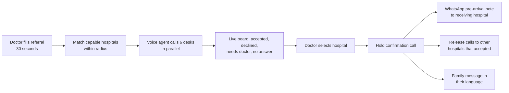

# Haazir — Product Blueprint

> **Working name.** An emergency referral router for Indian hospitals, built for the Bolna Symphony Buildathon 2026.
> Version 0.1 · 28 Oct 2026 · Source references like **[S4]** and **[B9]** point to `10-research-and-sources.md`.

---

## 1. The pitch in one breath

When a small hospital can't treat a critically ill patient, Haazir phones every capable hospital nearby **at the same time, in their language**, and hands the doctor a **confirmed bed with a recorded, timestamped answer**, so the doctor doesn't spend the golden hour dialling.

**Tagline:** *Dashboards show what a hospital typed yesterday. Haazir asks them now.*

---

## 2. The problem

**The story we open with.** It's 2 a.m. at a primary health centre near Hoskote. A 34-year-old farmer has a suspected krait bite. His eyelids are drooping and he's struggling to swallow, so he will probably need a ventilator soon. The PHC has none. The doctor starts dialling: casualty numbers that ring out, receptionists who transfer them, "call back later", and a bed portal that may be hours out of date.

**What's broken, with evidence**

| Failure | Evidence |
|---|---|
| Bed portals go stale or are wrong | In July 2026 the Delhi High Court ordered a surprise audit of 38 government hospitals after a patient was allegedly refused an ICU bed while the portal showed beds free. The audit must check whether bed data is accurate and whether emergency calls are answered **[S1]**. In September 2026 the 102 helpline became the ICU-bed number, with operators reading the same dashboard **[S2]**. |
| Same failure, other city, earlier | Bengaluru, April 2021: BBMP's bed data lagged real availability and patients went from hospital to hospital **[S4]**. A bed-blocking racket was alleged inside the central allocation system, and seven people were arrested **[S5][S6]**. |
| Referral chains break | Ambulances shuttle patients between hospitals looking for an ICU bed. Emergency beds are only 3–5% of hospital beds, although 18–40% of admissions come through emergency **[S7]**. |
| Critical care is scarce | India had about 2.3 ICU beds per 100,000 people in 2017 **[S8]**. Knowing *which* hospital has a free one right now matters. |
| Current fixes depend on hospitals updating screens | Aapat Setu, ICU Beds Saarthi and Bengaluru's CHBMS all need every hospital to register and keep data current **[S1][S9][S10][S30]**. |

**Root cause.** Live availability ("is a ventilator free right now?") is a fact held by a busy person at the casualty desk. Every existing system asks that person to *push* it into a screen. Haazir *pulls* it: it asks them at the moment it matters, on the channel they already answer, which is the phone.

---

## 3. Insights that shape the product

1. **Pull beats push.** Dashboards are only as fresh as their last update. A phone call gets the answer as of now, from the person who knows, without asking them to adopt anything.
2. **Store capability, ask availability.** What a hospital *can* do (has an ICU, has a cath lab) changes rarely, so we store it. Whether it *can take this patient now* changes hourly, so we ask.
3. **The phone is the universal API of Indian hospitals.** Every casualty desk has one. Few have an API, and many don't use any shared portal.
4. **Parallel beats sequential.** A doctor dials one hospital at a time; the agent calls six at once. The more hospitals that say no, the more time this saves.
5. **Trust has to be designed in.** Anonymous AI calls get hung up on: pharmacists already refuse stock questions from bots **[S14][S16]**. So every call names the referring doctor and facility, shares no patient identifiers on the first call, reads answers back, and discloses that it's automated and recorded.
6. **A recorded answer creates accountability.** A timestamped, recorded "yes" or "no" is exactly what the Delhi audit is trying to reconstruct **[S1]**. Over time this builds per-hospital acceptance rates.
7. **The directory of working direct numbers is the moat.** Bolna documents keypad (DTMF) support only for capturing a caller's key presses, not for pressing keys itself **[B15]**, so treat a reception IVR as a dead end. Direct casualty and referral-desk numbers that actually get answered are the real asset, and every call improves that directory.
8. **The doctor stays in charge.** The AI makes calls, not decisions. It never chooses the hospital and never dispatches the patient.
9. **Closing the loop is the product.** Other tools stop at "who has a bed" or "send the file". Haazir runs the whole loop: find, hold, hand off, release the others, and tell the family.
10. **Respect the desk.** A few short calls, prompt release calls, and no repeat calls to the same desk. Otherwise desks start ignoring our number.

---

## 4. Users

| Persona | Context | What they need | What Haazir gives them |
|---|---|---|---|
| **Referring doctor** (primary): PHC/CHC medical officer, casualty MO at a small hospital, ambulance-operator coordinator | Alone on a night shift with a deteriorating patient and no capacity on site | One place that answers "who will take this patient now?" without them making ten calls | A 30-second form, a live board, a confirmed bed, and a one-tap call to any desk |
| **Receiving desk**: casualty MO, nurse in charge, referral coordinator | Busy, interrupted, wary of unknown callers | A short, clear call: who is calling, what the case is, what's needed, and no time wasted | Under 60 seconds, a named doctor, a read-back, a WhatsApp pre-arrival note once they accept |
| **Patient's family** (attendant) | Frightened, may not read English | To know where to go and what to carry | A WhatsApp message (and, as a stretch goal, a call) in their language with the hospital, address, map link and reference code |
| **Buyer/admin**: ambulance or emergency-response operator, hospital network transfer desk, state emergency centre | Pays for faster, accountable placement | Speed, audit trail, acceptance analytics | Time-to-bed metrics, recorded answers, per-hospital acceptance and answer rates |

---

## 5. Product principles

1. **AI is one part of the product.** The voice agent is the interface to hospitals that won't install anything. The product is the referral workflow around it.
2. **The doctor decides.** The system recommends and executes calls. A human selects the hospital.
3. **Ask, don't assume.** A live answer beats stored availability every time.
4. **Minimum necessary data.** No patient identifiers on first calls. Identifying details go only to the hospital that accepted.
5. **Every answer is evidence.** Read back, timestamped, recorded, attributable.
6. **Respect the desk.** Bounded waves, short calls, prompt release.
7. **No paid ranking, ever.** Hospitals are ranked by capability, distance and track record only.
8. **Degrade gracefully.** If calls fail, the doctor still gets a ranked call list with tap-to-call.

---

## 6. Solution overview

**Components**

| Component | What it does | AI? |
|---|---|---|
| Referral console | Form with case templates, live board, map, timeline | No |
| Capability directory | Hospitals, their static capabilities, and contact numbers with answer-rate scores | No |
| Matching engine | Filters by required capabilities and radius; ranks by ETA, acceptance history and number quality | No (deterministic and explainable) |
| Case summary builder | Turns form fields into a 20-second spoken summary | No (template). An LLM never rewrites clinical facts |
| Call orchestrator | Dispatches waves, tracks state, triggers callbacks, wave 2, holds and releases | No |
| Voice agents (Bolna) | Hold the phone conversations in English, Hindi or Kannada, read answers back, and write structured answers to our API mid-call | **Yes** |
| Post-call extraction (Bolna) | Second, independent read of each call outcome, used to cross-check | **Yes** |
| Handoff | WhatsApp pre-arrival note, family message | No |
| Audit log and metrics | Every event timestamped; time-to-bed, answer and acceptance rates | No |

---

## 7. The core flow, step by step

| Time | What happens |
|---|---|
| T+0 | Doctor picks a case template (e.g. *Snakebite – neurotoxic*). Required capabilities pre-fill (*ICU bed, ventilator*). Doctor sets acuity, age, sex and a one-line note, sees a preview of **exactly what hospitals will hear**, and taps **Find a bed**. |
| T+2 s | Matching selects up to 6 capable hospitals within 40 km and orders them by ETA and track record. The board shows why each one was chosen. |
| T+5 s | Six Bolna calls are dispatched at once, each starting in the hospital's language. |
| T+15–60 s | Desks answer. The agent introduces itself as an automated assistant for Dr. Meera Rao, reads the summary, asks "Can you accept now? Is an ICU bed with a ventilator free?", reads the answer back, and records it through a mid-call function. **The pin turns green while the call is still live.** |
| T+30–120 s | **First confirmed acceptance (TTFA).** Accepted options are listed by ETA with conditions and a contact name. "Needs doctor" requests show a tap-to-call banner. |
| Doctor's choice | Doctor taps **Select** on a hospital. |
| +20 s | Hold confirmation call: "Dr. Rao is sending the patient to you, ETA about 18 minutes, reference R-4821. Please keep the bed ready." Confirmed with a name. |
| +5 s | WhatsApp pre-arrival note goes to the receiving hospital. Patient name is included **only now**. A message goes to the family in their language. |
| +10 s | Release calls go to the other hospitals that had accepted: "Thank you; the patient has been placed elsewhere." |
| Later | The hold expires automatically (ETA + 30 minutes) unless the patient is marked as arrived. Everything is in the timeline. |

If no hospital accepts within 150 seconds, or all calls finish without a yes, **wave 2** dials the next six. If both waves fail, the board shows a ranked tap-to-call list and the referral is marked *exhausted*.

---

## 8. Scope

### Must have (MVP and demo)

| ID | Capability |
|---|---|
| M1 | Referral form with case templates, editable required capabilities and a spoken-summary preview |
| M2 | Capability-and-radius matching with ETA ranking and "why this hospital" reasons |
| M3 | Parallel availability calls through Bolna (wave of 6) with per-call `user_data` |
| M4 | Mid-call `record_hospital_response` function with read-back before recording |
| M5 | Status webhooks driving a realtime live board (map plus cards) |
| M6 | Select, then hold confirmation call, then confirmed state with hold expiry |
| M7 | Release calls to other hospitals that accepted |
| M8 | WhatsApp pre-arrival note to the receiving hospital (or a simulated message shown in the UI) |
| M9 | Timeline/audit log and the TTFA metric on screen |
| M10 | English plus Kannada (and Hindi) calls with mid-call language switching |
| M11 | Demo control panel: reset, assign phone numbers, simulation mode |
| M12 | No patient identifiers on availability calls (enforced in code) |

### Should have

| ID | Capability |
|---|---|
| S1 | Wave 2 and the *exhausted* state with a tap-to-call fallback list |
| S2 | "Needs doctor" alert with tap-to-call (`request_doctor_callback`) |
| S3 | "Call me back in N minutes" handling (`request_callback`) with our own scheduler |
| S4 | Post-call extraction cross-check that flags conflicts as *needs review* |
| S5 | Facilities admin: capabilities, contacts, IVR flag, answer and acceptance stats |
| S6 | Inbound callback handling (a hospital calls our number back) |
| S7 | Manual outcome entry and redial to an alternate number |

### Could have (stretch)

| ID | Capability |
|---|---|
| C1 | Family voice call in their language |
| C2 | Doctor intake by WhatsApp voice note, transcribed into the form for the doctor to confirm |
| C3 | Missed-call trigger for feature-phone users |
| C4 | Mismatch flags against public bed portals ("portal says free, desk says full") |
| C5 | Acceptance analytics page per hospital and per time of day |
| C6 | Hospital "quick reply" on WhatsApp instead of voice |
| C7 | Aapat Setu link in the pre-arrival note |
| C8 | Max-ETA rule by acuity (e.g. critical cases skip options more than 60 minutes away) |

### Won't do (now)

Medical advice of any kind · automatic dispatch without the doctor · payments or deposits · paid placement or ranking · EHR integration.

---

## 9. Key user stories

| ID | Story | Acceptance criteria |
|---|---|---|
| US1 | As a referring doctor, I can start a referral in under 30 seconds | Template pre-fills capabilities; required fields are 5 or fewer; preview shows the spoken summary |
| US2 | As a referring doctor, I see each hospital's status live | Pin and card update within 2 s of the webhook or function event, with no page refresh |
| US3 | As a referring doctor, I see accepted options sorted by ETA with conditions and a contact | Accepted and conditional cards show bed type, ready-in minutes, contact and conditions |
| US4 | As a receiving desk, I know who is calling and why within 15 seconds | Welcome message names the doctor and facility and says it's an automated call that is recorded |
| US5 | As a receiving desk, I'm never asked for or given patient identifiers before accepting | Availability `user_data` contains no name or phone; a test checks this |
| US6 | As a referring doctor, I can talk to a desk that wants to talk to me | Banner with tap-to-call appears within 2 s of `request_doctor_callback` |
| US7 | As a receiving desk that accepted, I get a pre-arrival note when chosen | WhatsApp (or simulated message) sent within 10 s of hold confirmation |
| US8 | As a receiving desk that accepted but wasn't chosen, I'm told promptly | Release call is dispatched within 10 s of hold confirmation |
| US9 | As a family member, I know where to go, in my language | Message in the attendant's language with hospital, address, map link and reference code |
| US10 | As an admin, I can audit any referral | Timeline shows every event with timestamps; recordings and transcripts are linked per call |

---

## 10. Success metrics

| Metric | Definition | Demo target | Pilot goal |
|---|---|---|---|
| **TTFA** (north star) | Seconds from referral submit to the first recorded accepted or conditional outcome | under 3 minutes on stage | Measure the median across real consented tests, then reduce it |
| Answer rate | Answered availability calls ÷ dialled, per number | n/a | Find which number types get answered |
| Acceptance rate | Accepted ÷ answered | n/a | Per hospital and per hour |
| Outcome accuracy | Captured outcome matches the recording (manual audit) | 100% on stage | 95% or better |
| Calls per placed referral | Total calls ÷ referrals with a confirmed bed | 6 or fewer | Fewer over time as ranking improves |
| Doctor phone time | Minutes the doctor spends on calls per referral | ~0 on stage | Measured in interviews and observation |

---

## 11. Positioning and differentiation

| Category | Examples | What they do | Gap Haazir fills |
|---|---|---|---|
| Bed dashboards | Delhi ICU Beds Saarthi, BBMP CHBMS, AIIMS casualty dashboard **[S1][S11][S30]** | Show availability that hospitals enter | Data is only as fresh as the last update; Haazir asks live |
| Referral file sharing | Aapat Setu (AIIMS Bilaspur) **[S9][S10]** | Sends the patient's file ahead to the chosen hospital | Doesn't find *who will take the patient*; needs hospitals registered. **Complementary**: our note can carry its link |
| EMS–hospital coordination | Pulsara (US), Red Health (India) **[S18][S20][S21]** | Pre-arrival alerts, ambulance coordination | Need both sides on their platform, or human coordinators |
| AI that phones around | Google "Ask for Me", Needle, FindUrMeds, WWT discharge agent **[S12][S14][S15][S17]** | Calls businesses, pharmacies or nursing homes to check availability | Not for emergencies, not in Indian languages, and results take up to 30 minutes in Google's case |
| Indian healthcare voice AI | Bolcho, HuskyVoice **[S24][S25]** | Answer a hospital's *inbound* calls | Inbound reception, not outbound referral search |

**Five differentiators**

1. **Pull, not push.** We only need a phone number, not a sign-up.
2. **Emergency speed.** Parallel calls, a three-question script and a live board. We measure TTFA.
3. **Trust design.** Named doctor, no identifiers on first call, read-back, recorded with disclosure.
4. **Closed loop.** Find, hold, hand off, release and inform the family.
5. **Truth layer.** Timestamped answers, and later mismatch flags against portals.

---

## 12. Business model

- **First buyer to pitch:** emergency-response and ambulance operators. Every patient turned away at the door costs them time and money, and they already coordinate with hospitals by phone. Sell per referral or per seat.
- **Next:** hospital networks' outbound transfer desks (when their own ICU is full), then state emergency centres such as 102/108. The Delhi court asked whether helpline callers could be routed to hospitals with beds and staff **[S3]**, but government procurement is slow.
- **Unit cost:** about 6–9 calls per referral (6 availability, 1 confirmation, up to 2 releases), each under a minute. Price per referral should be a multiple of that call cost. Check Bolna's pricing page for per-minute rates before quoting numbers.
- **Non-negotiable:** ranking is never for sale. If a hospital could pay to be called first, patients would be routed by money.

---

## 13. Risks and mitigations

| Risk | Mitigation |
|---|---|
| Desks don't answer unknown numbers | Indian caller ID, direct desk numbers, one redial on busy, alternate numbers, answer-rate scoring. Measure it in validation |
| Desk hears an AI and hangs up | Name the doctor and facility first, keep it short, and offer a doctor callback |
| Mis-heard answer ("nahi" heard as "haan") | Read-back before recording, post-call extraction cross-check, *needs review* on conflict, hold confirmation call, doctor sees recording |
| Hospital says yes, then refuses at the door | Recorded answer with a named contact, hold confirmation call, acceptance analytics over time |
| Bed-blocking abuse | Holds tied to a real referral and doctor, auto-expiry, one active hold per referral, full audit, no payments |
| Privacy (DPDP) | No identifiers on first calls, AI and recording disclosure, retention limits. See `09-validation-safety-compliance.md` |
| Bolna trial limits break the demo | Trial allows 2 concurrent calls to verified numbers only; paid starts at 10 **[B9]**. Check the tier before demo day |
| Stage telephony or network fails | Simulation mode replays a recorded run (labelled as such), plus a backup video |
| Scope creep | MVP is the core loop only. The cut list is in `07-build-plan.md` |
| Clinical templates are wrong | Templates are editable defaults flagged *not clinician-reviewed* until a doctor reviews them |

---

## 14. Where this entry stands (field scan, 28 Oct 2026)

From the Bolna Builders Slack introductions, scored on seven criteria out of 70:

| Rank | Entry | Score | Note |
|---|---|---|---|
| 1 | voice-doctor (Bolna agent debugger) | 48 | Shipped, Bolna-specific, but nobody pays for it |
| **2** | **Haazir, as pitched** | **43** | Highest impact (9) and demo (9); proof is 1 out of 10 |
| 3 | Swarelic (voice agent builder) | 42 | Overlaps with Bolna itself |

- **Showcase-style judging** (impact and demo count double): Haazir ranks 1st.
- **Investor-style judging** (proof and who pays count double): Haazir drops to 7th of 9.
- **Fix three things:** proof (consented real test calls plus doctor interviews), a named buyer, and a cut scope. That gives **52/70 and 1st under every lens**. Details are in `10-research-and-sources.md` §4.

---

## 15. Open decisions

| # | Decision | Default until decided |
|---|---|---|
| D1 | Product name (Haazir was mocked in review) | Keep "Haazir" internally; shortlist: *Haazir*, *BedCall*, *Pahunch* |
| D2 | First buyer to pitch | Ambulance and emergency-response operators |
| D3 | Which hospital or doctor consents to test calls | Ask your faculty contacts and any hospital you know personally. Needed by mid-build |
| D4 | WhatsApp provider | `none` (simulated in UI) → Twilio sandbox or Meta test number if time allows |
| D5 | Live transfer on stage vs callback | Callback with tap-to-call (per-call transfer destination isn't documented **[B11]**). Optional demo transfer to a fixed demo-doctor phone |
| D6 | Real buildathon dates and judging rubric | Fill into `07-build-plan.md` and re-weight the pitch |

---

## 16. Glossary

| Term | Meaning |
|---|---|
| Referral | One patient who needs to move to a more capable hospital |
| Attempt | One phone call for a referral (availability, hold confirmation, release, or family update) |
| Wave | A batch of parallel availability calls (default 6) |
| Capability | What a hospital can do at all (ICU, cath lab). Stored |
| Availability | Whether it can take *this* patient *now*. Asked on the call |
| Hold | A hospital's confirmed promise to keep a bed for a specific referral until it expires |
| Release | Telling a hospital that accepted but wasn't chosen that it can free the bed |
| TTFA | Time to first acceptance |
| Referral code | Short spoken reference like **R-4821** used on calls and messages |

---

**Where to go next:** `02-architecture.md` (how it works) → `05-voice-agents.md` (what the agent says) → `07-build-plan.md` (what to build first).
