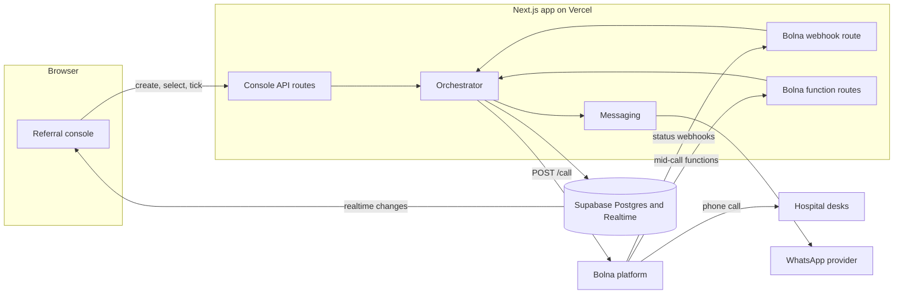
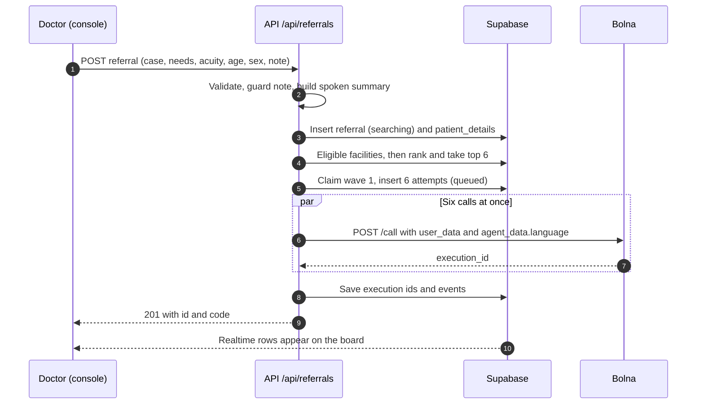
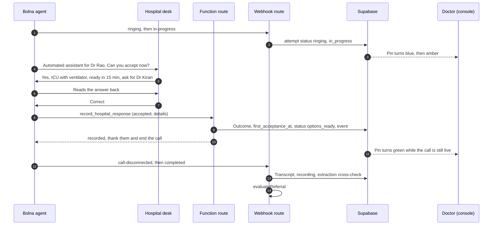
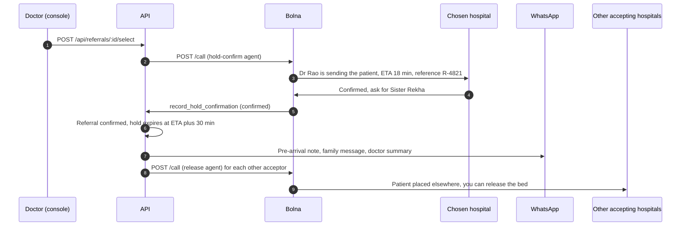
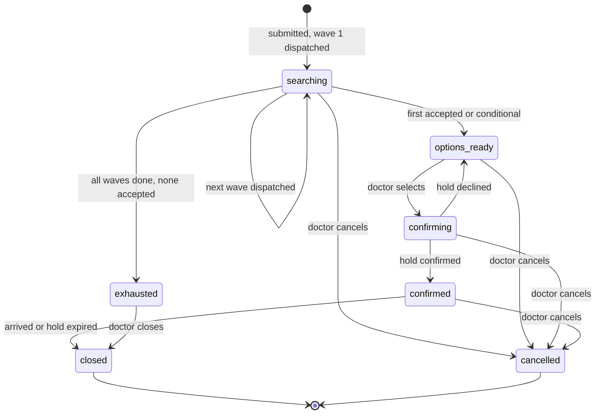
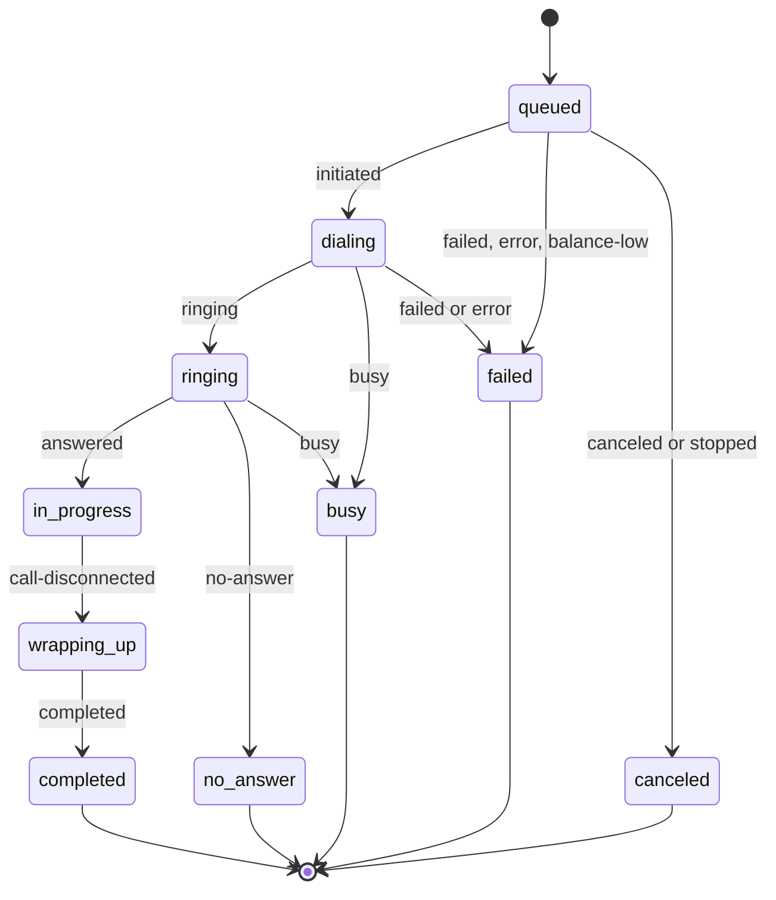

# 02 · Architecture

How Haazir works end to end: stack, flows, state machines, orchestration, matching, realtime, simulation, security and deployment.

---

## 1. Stack (decided, so nobody debates it during the build)

| Layer | Choice | Why |
|---|---|---|
| Web app and API | **Next.js (App Router, TypeScript)** on **Vercel** | One deploy gives you the UI, API routes and a public HTTPS URL that Bolna can call back. The Slack suggests a live link may be part of submission |
| Database and live updates | **Supabase** Postgres + Realtime (`postgres_changes`) | The live board updates without running your own websocket server |
| Voice | **Bolna**: agents, `POST /call`, custom functions, extractions, webhooks | The point of the buildathon, and it covers telephony, Indian-language speech and tool calls |
| Map | **Leaflet + react-leaflet + OpenStreetMap tiles** | No API key; credit OpenStreetMap on the map |
| Messaging | WhatsApp through Meta Cloud API *or* Twilio sandbox; `none` = simulated and shown in the UI | Approval delays can't block the demo |
| Validation | **zod** on every route | Webhook and function payloads are untrusted |
| UI kit | Tailwind + shadcn/ui | Fast, accessible components |
| Local callbacks | ngrok or cloudflared tunnel | Bolna must reach your laptop during development |

*If the team strongly prefers Python:* FastAPI on Railway or Render with the same Postgres schema works. Realtime then needs your own websocket or Supabase Realtime from the browser. Pick one stack on day 0 and don't switch.

---

## 2. System context



---

## 3. Components

| Component | File | Responsibility |
|---|---|---|
| Referral API | `app/api/referrals/**` | Validate input, build the spoken summary, create the referral, start wave 1, select, cancel, close, tick |
| Matching | `lib/modules/facility/matching.helper.ts` (SQL in `facility.repository.ts`) | Eligibility (SQL in `03-data-model.md` §5.1), ranking, contact choice, "why this hospital" reasons |
| Summary builder | `lib/modules/referral/summary.helper.ts` | Deterministic spoken summary; identifier guard on the note |
| Orchestrator | `lib/modules/referral/evaluation.service.ts`, `referral.helper.ts`, `lib/modules/call/call.service.ts` | `CallService.dispatchWave`; `EvaluationService.evaluate` applies the steps `planEvaluation` plans (callbacks, waves, hold expiry, releases). Idempotent |
| Bolna client | `lib/integrations/bolna/bolna.client.ts` | `makeCall()`, `getExecution()`, `stopCall()`; swapped for the simulator in simulation mode |
| Status mapper | `lib/modules/call/status.helper.ts` | Bolna status → our status, monotonic ordering, termination reason → outcome hints |
| Webhook route | `app/api/bolna/webhook/route.ts` | Auth, raw log, status update, reconcile on `completed`, evaluate |
| Function routes | `app/api/bolna/functions/*/route.ts` | Mid-call writes: response, doctor callback, call back later, hold confirmation |
| Messaging | `lib/modules/handoff/whatsapp.service.ts` (providers in `lib/integrations/whatsapp/`) | Provider adapter (`meta`, `twilio`, `none`); always writes `messages` plus a redacted `events` entry |
| Simulator | `lib/modules/demo/simulator.service.ts` | Replays `scenarios/*.json` through the same handlers (§10) |
| Realtime UI | `app/referrals/[id]/page.tsx` | Subscribes to `referrals`, `call_attempts` and `events` for one referral |

---

## 4. Key flows

### 4.1 Create a referral and dispatch wave 1



### 4.2 One availability call, with the answer written mid-call



### 4.3 Select, confirm the hold, hand off, release



If the hold is declined, the referral goes back to `options_ready` and the doctor picks again. **Manual confirm** (`/confirm-manually`) is always available: if the doctor already spoke to the hospital, skip the call.

### 4.4 "Can I talk to the doctor?"

The agent calls `request_doctor_callback`, tells the desk "Dr Rao will call you back on this number within two minutes", and ends the call politely. The board shows a red banner with a **tap-to-call** link (`tel:`) to that desk. The doctor records the result with **manual outcome**.
*Why not a live transfer?* Bolna's transfer destination is set on the tool, and a per-call destination isn't documented **[B11]**. For the stage demo you can configure the transfer tool to the demo doctor's fixed phone (see `05-voice-agents.md` §7).

---

## 5. State machines

### 5.1 Referral



Calls still running when the doctor selects keep going. If they accept after the selection, they get a release call too.

### 5.2 Call attempt



### 5.3 Bolna status → our status

| Bolna `status` [B6][B7] | Our `status` | Side effects |
|---|---|---|
| `scheduled`, `queued` | `queued` | — |
| `rescheduled` | `queued` | **Alert**: calling guardrails are on. Turn them off or bypass |
| `initiated` | `dialing` | `dispatched_at` if not set |
| `ringing` | `ringing` | — |
| `in-progress` | `in_progress` | `answered_at = now()` |
| `call-disconnected` | `wrapping_up` | `ended_at = now()`. **Final fields aren't ready yet** |
| `completed` | `completed` | Read `transcript`, `telephony_data.recording_url`, `extracted_data`, `termination_reason`; reconcile |
| `no-answer` | `no_answer` | Maybe redial an alternate number |
| `busy` | `busy` | One redial after 45 s |
| `failed`, `error` | `failed` | Event with `error_message` |
| `balance-low` | `failed` | **Alert**: top up the Bolna wallet |
| `canceled`, `stopped` | `canceled` | — |

**Monotonic updates:** rank `queued 0 < dialing 1 < ringing 2 < in_progress 3 < wrapping_up 4 < terminal 5`. Ignore any webhook that would move an attempt backwards, since webhooks can arrive late or twice. Once terminal, only `wrapping_up → completed` is allowed.

### 5.4 Reconciling the outcome on `completed`

1. **Function outcome present, extraction agrees or is missing:** keep it.
2. **Function outcome present, extraction disagrees** (e.g. function says `accepted`, extraction says `declined`): set `needs_review = true`, raise a `needs_review` event, and show **"Check recording"** on the card. Never auto-select a hospital under review.
3. **No function outcome:** use the extraction `objective` if `confidence_label` is High or Medium (`outcome_source = 'extraction'`); otherwise `unclear`.
4. `termination_reason = 'voicemail_reached'`, or extraction says IVR or recording: outcome `ivr_blocked`; suggest adding a direct number.
5. Update the contact: `calls_made + 1`, plus `calls_answered + 1` if `answered_at` is set.

---

## 6. Orchestration

### 6.1 Constants (in `lib/core/config.ts`)

| Name | Default | Meaning |
|---|---|---|
| `WAVE_SIZE` | 6 | Parallel availability calls per wave. Keep it at your Bolna concurrency minus 3, so confirmation and release calls never queue |
| `WAVE_TIMEOUT_S` | 150 | Start the next wave if nobody has accepted after this long |
| `MAX_WAVES` | 2 | Then `exhausted` with a tap-to-call list. A wave only opens while nobody has accepted |
| `HOLD_BUFFER_MIN` | 30 | Hold expiry = ETA + buffer |
| `CALLBACK_MAX_MIN` | 10 | Cap for "call me back in N minutes" |
| `BUSY_REDIAL_AFTER_S` | 45 | One redial on `busy`, then try the next contact |
| Road factor (in the matching SQL, `lib/modules/facility/facility.repository.ts`) | 1.4 | Straight-line to road distance |
| Average speed (same SQL) | 30 km/h | Ambulance speed estimate. ETA = km × 1.4 ÷ 30 × 60 |
| `DEFAULT_RADIUS_KM` | 40 | Search radius |
| `TICK_INTERVAL_MS` | 5000 (1000 in simulation) | Console tick while a referral is active |

### 6.2 Where the clock lives

Serverless functions can't hold timers. Bolna's own scheduling doesn't help either: `scheduled_at` must be at least 2 minutes ahead and is rounded up to the next 10-minute mark, and `retry_config` intervals are in minutes **[B1][B19]**. So:

- `evaluateReferral(id)` runs **after every webhook and function call**, and
- the open console calls `POST /api/referrals/:id/tick` every `TICK_INTERVAL_MS` while the referral is active.

Both paths are idempotent: they read state, decide, and use the atomic wave claim (`03-data-model.md` §5.4). A closed laptop only delays time-based steps (wave 2, callbacks, hold expiry); call outcomes still arrive by webhook. For a pilot, add a Supabase cron job or a small always-on worker.

### 6.3 `evaluateReferral` (pseudo-code)

```ts
async function evaluateReferral(id: string) {
  const r = await loadReferralWithAttempts(id);
  if (["cancelled", "closed"].includes(r.status)) return;

  const avail = r.attempts.filter(a => a.purpose === "availability");
  const accepted = avail.filter(a => ["accepted", "conditional"].includes(a.outcome) && !a.needs_review);

  // 1. First acceptance
  if (accepted.length && !r.first_acceptance_at) {
    await setFirstAcceptance(r, accepted[0]);                 // also status searching → options_ready
  }

  // 2. Due callbacks ("call me back in N minutes")
  for (const a of avail.filter(isCallbackDue)) await redial(a, { reason: "callback" });

  // 3. One redial on busy, after BUSY_REDIAL_AFTER_S
  for (const a of avail.filter(isBusyRedialDue)) await redial(a, { reason: "busy" });

  // 4. Next wave, or exhausted
  if (r.status === "searching" && accepted.length === 0) {
    const active = avail.filter(a => !isTerminal(a.status) || isPendingRedial(a));
    const waveAge = secondsSince(r.wave_started_at);
    if ((active.length === 0 || waveAge > WAVE_TIMEOUT_S) && r.current_wave < MAX_WAVES) {
      if (await claimWave(r.id, r.current_wave)) await dispatchWave(r, r.current_wave + 1);
    } else if (active.length === 0 && r.current_wave >= MAX_WAVES) {
      await setStatus(r, "exhausted");
    }
  }

  // 5. Late acceptances after the doctor already chose: release them
  if (["confirming", "confirmed"].includes(r.status)) {
    for (const a of accepted.filter(a => a.id !== r.selected_attempt_id && !hasRelease(r, a))) {
      if (r.status === "confirmed") await dispatchRelease(r, a);
    }
  }

  // 6. Hold expiry
  if (r.status === "confirmed" && r.hold_expires_at && now() > r.hold_expires_at) {
    await addEventOnce(r, "hold_expired");                    // UI prompts: arrived? extend? close?
  }
}
```

### 6.4 Dispatching a call

```ts
async function dispatchCall(attempt: Attempt, agentId: string, userData: Record<string, unknown>) {
  const res = await bolna.makeCall({
    agent_id: agentId,
    recipient_phone_number: attempt.to_number,
    from_phone_number: env.BOLNA_FROM_NUMBER || undefined,
    user_data: { ...userData, attempt_id: attempt.id, timezone: "Asia/Kolkata" },
    agent_data: { language: attempt.call_language },       // must match a language configured on the agent
    bypass_call_guardrails: true,                           // emergencies are 24x7
  });                                                       // retry_config omitted on purpose: we redial ourselves
  await markDispatched(attempt.id, res.execution_id);
}
```

`Promise.allSettled` across the wave: one failed dispatch (e.g. a 400 on a bad number) marks that attempt `failed` without blocking the others.

---

## 7. Matching and ranking

1. **Eligible:** active; not the origin; has **every** required capability (`declared` or `confirmed`); within `search_radius_km`; has at least one active contact. (SQL in `03-data-model.md` §5.1.)
2. **Score** (0–1, higher is better):
   - `time = 1 − min(eta_minutes / 90, 1)`
   - `acceptance = (accepted + 1) / (answered + 2)` (smoothed so new hospitals start at 0.5)
   - `answer = (calls_answered + 1) / (calls_made + 2)` for the best contact, halved if that contact is IVR-only
   - `score = 0.5·time + 0.3·acceptance + 0.2·answer`, ties broken by distance
3. **Contact choice:** the lowest `priority` among non-IVR active contacts; IVR numbers only as a last resort.
4. **Reasons shown on the card:** `"18 min away"`, `"has ICU bed + ventilator"`, `"accepted 3 of 4 recent"` (only if 3 or more answered calls), `"IVR line only"` (warning).
5. **Never** an input: payments, partnerships, or anything a hospital can buy.

*Next improvement (C8):* a maximum ETA by acuity, e.g. critical cases skip options more than 60 minutes away unless nothing else is available.

---

## 8. Spoken case summary

Deterministic, never LLM-written, and stored on the referral (`spoken_summary`) for audit.

```
{who}, {case_spoken}, {acuity}. {note_normalised} Needs {needs_spoken}.
```

| Part | Rule | Example |
|---|---|---|
| `who` | Age ≥ 18: "Man/Woman/Patient aged N"; 13–17: "Teenage boy/girl, N years"; 1–12 years: "Boy/Girl/Child aged N"; days or months: "Baby, N days old" | Man aged 34 |
| `case_spoken` | `case_templates.spoken_en` | suspected snakebite with neurotoxic signs |
| `acuity` | critical, serious or stable | critical |
| `note_normalised` | Expand: ASV → anti-snake venom, `+` → and, `h`/`hrs` → hours, BP → blood pressure, SpO2 → oxygen saturation, GCS → G C S | Drooping eyelids and trouble swallowing 2 hours after bite. Given 10 vials of anti-snake venom. |
| `needs_spoken` | `capabilities.spoken_en` joined with commas and "and" | an ICU bed and a ventilator |

**Input note:** `Drooping eyelids and trouble swallowing 2 hrs after bite. Given 10 vials of ASV.`
**Result:** "Man aged 34, suspected snakebite with neurotoxic signs, critical. Drooping eyelids and trouble swallowing 2 hours after bite. Given 10 vials of anti-snake venom. Needs an ICU bed and a ventilator."

**Identifier guard on the note:** reject phone-number-like digit runs (9 or more digits), Aadhaar-like `\d{4}\s?\d{4}\s?\d{4}`, and emails. Warn (but don't block) on honorifics followed by a capitalised word (`Mr|Mrs|Ms|Shri|Smt|Kumari`). The form shows the preview, so the doctor sees exactly what will be said.

---

## 9. Realtime

Tables in the `supabase_realtime` publication: `referrals`, `call_attempts`, `events` (added by the migration).

```ts
const channel = supabase
  .channel(`referral:${id}`)
  .on("postgres_changes", { event: "*", schema: "public", table: "call_attempts", filter: `referral_id=eq.${id}` }, onAttempt)
  .on("postgres_changes", { event: "UPDATE", schema: "public", table: "referrals", filter: `id=eq.${id}` }, onReferral)
  .on("postgres_changes", { event: "INSERT", schema: "public", table: "events", filter: `referral_id=eq.${id}` }, onEvent)
  .subscribe();
```

Load the full state once with `GET /api/referrals/:id`, then apply realtime changes. On reconnect, refetch.

---

## 10. Simulation mode

**Why:** the frontend can be built before telephony works, and it's the stage fallback if the venue network or telephony fails.

- `SIMULATION_MODE=true` simulates every referral. On the demo deployment you can also send `"simulate": true` on a single `POST /api/referrals` (the "Run as simulation" checkbox), so the stage fallback needs no redeploy.
- A simulated referral is marked `is_simulated`, and `bolna.makeCall()` returns `sim_<uuid>` instead of calling Bolna.
- `scenarios/demo-krait-bite.json` scripts each facility: when it rings, answers, which outcome and details it gives, and when it ends.
- Each **tick** (every 1 s in simulation) applies scripted steps that are due **through the same handlers** the real webhook and function routes use, with `outcome_source = 'simulation'`. The board can't tell the difference, so it's a faithful test of the UI and orchestrator.
- The UI shows a **SIMULATED** badge. On stage, say so if you fall back to it.

---

## 11. Security

| Surface | Control |
|---|---|
| Bolna → function routes | `api_token` in the tool config sends `Authorization: Bearer <BOLNA_FUNCTION_SECRET>`; reject anything else with 401 |
| Bolna → webhook route | Secret in the URL (`?token=<BOLNA_WEBHOOK_SECRET>`) or a custom header (the dashboard supports **Add headers**) **[B5]** |
| Source IPs (optional) | Bolna calls from 13.203.39.153, 13.126.9.249, 13.202.133.53 **[B5][B19]**. Check `x-forwarded-for` on Vercel. Don't rely on this alone |
| Inputs | zod on every route. Treat `""`, `"None"`, `"null"` and unreplaced `%(name)s` tokens as missing |
| Secrets | Server-only env vars. Never expose `BOLNA_API_KEY` or `SUPABASE_SERVICE_ROLE_KEY` to the browser |
| Data | RLS as in `03-data-model.md` §4. No identifiers in `events` or availability `user_data`. Never log message bodies or `patient_details` |
| Console access (MVP) | Passcode gate in Next.js middleware (`DEMO_PASSCODE`). Pilot: Supabase Auth plus org-scoped RLS |

---

## 12. Environments and deployment

| Environment | App URL | Bolna agents |
|---|---|---|
| Local | `https://<tunnel>.ngrok.app` | **Dev copies** of each agent with webhook and function URLs pointing at the tunnel |
| Production / demo | `https://haazir.vercel.app` (or yours) | **Demo agents** pointing at the production URL |

Webhook and function URLs live **inside the agent configuration**, so keep separate dev and demo agents rather than editing URLs back and forth. Env vars are listed in `.env.example`.

---

## 13. Bolna constraints that shape this design

| Constraint | Source | Design response |
|---|---|---|
| Trial: **2** concurrent calls, verified numbers only; paid starts at **10**; extra calls queue | [B9] | Check the tier before demo day; `WAVE_SIZE ≤ concurrency − 3` |
| Keypad (DTMF) is documented only for capturing a caller's presses, not sending them, so don't count on getting through phone menus | [B15] | Direct desk numbers first; IVR flag; `ivr_blocked` outcome |
| Transfer destination is set on the tool; per-call destination not documented | [B11] | Doctor-callback pattern; fixed-number transfer only for the demo |
| Read transcript, recording and extractions only at `completed` | [B6][B19] | Reconcile on `completed` |
| Webhook on every status change, possibly out of order | [B5] | Monotonic status updates |
| `scheduled_at` ≥ 2 min ahead, rounded up to 10 min; numeric UTC offset only | [B19] | Our own tick-based scheduler |
| `retry_config` intervals are in minutes | [B1] | Our own redial logic |
| Calling guardrails reschedule out-of-window calls | [B10] | Guardrails off; `bypass_call_guardrails: true` |
| Function `param` uses `%(name)s`; POST sends JSON; prompt context variables are auto-filled | [B2][B3][B4] | `attempt_id` in `user_data`; `to_number` fallback |
| Multilingual agents switch mid-call; start language via `agent_data.language` | [B1][B14] | `facilities.call_language` |
| Extraction results nested by category and name, with `objective` and `confidence_label` | [B13] | Fallback outcome and conflict check |

---

## 14. Suggested folder structure

```
haazir/
├─ app/
│  ├─ page.tsx                         # new referral + recent referrals
│  ├─ referrals/[id]/page.tsx          # live board
│  ├─ facilities/page.tsx              # directory admin
│  ├─ demo/page.tsx                    # demo control panel
│  ├─ history/page.tsx                 # TTFA per referral (should-have)
│  └─ api/
│     ├─ referrals/route.ts            # POST create
│     ├─ referrals/preview/route.ts    # POST preview (no side effects)
│     ├─ referrals/[id]/route.ts       # GET
│     ├─ referrals/[id]/select/route.ts
│     ├─ referrals/[id]/confirm-manually/route.ts
│     ├─ referrals/[id]/cancel/route.ts
│     ├─ referrals/[id]/close/route.ts
│     ├─ referrals/[id]/tick/route.ts
│     ├─ attempts/[id]/manual-outcome/route.ts
│     ├─ attempts/[id]/redial/route.ts
│     ├─ facilities/route.ts, facilities/[id]/route.ts
│     ├─ facilities/[id]/capabilities/route.ts, facilities/[id]/contacts/route.ts
│     ├─ contacts/[id]/route.ts
│     ├─ demo/reset/route.ts, demo/assign-numbers/route.ts, demo/test-call/route.ts
│     └─ bolna/
│        ├─ webhook/route.ts
│        └─ functions/{record-response,request-doctor,request-callback,record-hold,inbound-callback}/route.ts
├─ lib/  (config, bolna, simulator, orchestrator, matching, summary, statusMap, whatsapp, supabase, validation)
├─ scenarios/demo-krait-bite.json
├─ supabase/migrations/0001_init.sql
├─ supabase/seed.sql
├─ bolna/  (prompts and tool JSON from this pack)
└─ docs/   (this pack)
```
