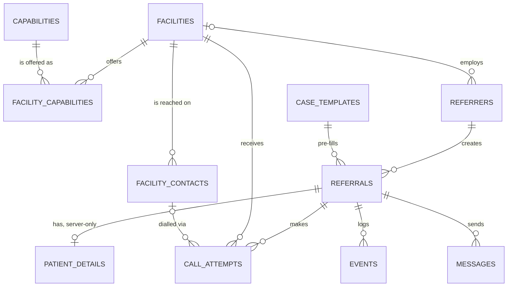

# 03 · Data Model

Postgres on Supabase. Exact DDL: `supabase/migrations/0001_init.sql`. Demo data: `supabase/seed.sql`.
Both were run against PostgreSQL 16 together with the queries in §5 (tested 28 Oct 2026).

---

## 1. Entities



| Table | Purpose | Browser can read? |
|---|---|---|
| `capabilities` | Catalogue of static capabilities (ICU bed, cath lab…) with a spoken phrase | Yes |
| `case_templates` | Case type → default required capabilities (editable, *not clinician-reviewed*) | Yes |
| `facilities` | Hospitals and clinics, location, call language, WhatsApp number | Yes |
| `facility_contacts` | Phone numbers per facility: role, priority, IVR flag, answer stats | Yes |
| `facility_capabilities` | Which static capabilities each facility has | Yes |
| `referrers` | Referring doctors | Yes |
| `referrals` | One per patient who needs moving. **No identifiers** | Yes |
| `patient_details` | Patient and attendant identifiers, shared only after acceptance | **No** (server only) |
| `call_attempts` | One per phone call, including outcome, recording and transcript | Yes |
| `events` | Append-only audit log. **No identifiers in payloads** | Yes |
| `messages` | Outbound WhatsApp/SMS bodies (may contain the patient name) | **No** (server only) |
| `bolna_webhook_log` | Raw webhook payloads for debugging | **No** (server only) |

---

## 2. Key columns and rules

### `facilities`
- `call_language`: the Bolna language key the call starts in (`en`, `hi`, `kn`, …). It's sent as `agent_data.language`, so it must match a language configured on the agent.
- `whatsapp_number`: where the pre-arrival note goes. If null, the message is stored as `simulated` and shown in the UI.
- `is_demo`: demo rows are fictional; the Demo page can wipe and reseed them.

### `facility_contacts`
- `priority`: 1 is tried first. **Non-IVR numbers always come before IVR numbers**, because Bolna documents no way for the agent to press keys and get through a phone menu.
- `calls_made` / `calls_answered`: updated on every completed attempt; they feed the number-quality score.
- `phone_e164`: checked by the regex `^\+[1-9][0-9]{7,14}$`.

### `facility_capabilities`
- Static only: "has a ventilator", not "a ventilator is free". `status` ∈ `declared | confirmed | not_available | unknown`. Matching uses `declared` or `confirmed`.

### `referrals`
- `code`: spoken reference (`R-4821`), generated by `next_referral_code()`.
- `note`: at most 160 characters; the API also rejects anything that looks like a name or phone number (see `04-api-spec.md`).
- `spoken_summary`: **the exact text hospitals hear**, frozen at creation for auditability.
- `current_wave` / `wave_started_at`: used by the atomic wave claim (§5.4).
- `first_acceptance_at`: set once, on the first `accepted` or `conditional` outcome. This drives TTFA.
- `selected_attempt_id`, `selected_facility_id`, `hold_expires_at`: the active hold. A referral can only have one.

### `call_attempts`
- `purpose`: `availability | hold_confirm | release | family_update`.
- `status` (our state) versus `bolna_status` (raw); see the mapping in `02-architecture.md` §5.3.
- `outcome` + `outcome_source` (`function | extraction | manual | simulation`).
- `extraction_outcome`: Bolna's post-call extraction result, kept separately so conflicts are visible. A conflict sets `needs_review = true`.
- `parent_attempt_id`: redials and callbacks point at the original attempt.
- `rank_reasons`: JSON array of short strings shown as "why this hospital" chips, e.g. `["18 min away","has ICU + ventilator","answered 4 of 5 calls"]`.

---

## 3. Enumerations

**Referral status**

| Value | Meaning |
|---|---|
| `draft` | Created but not dispatched (unused in the MVP; reserved) |
| `searching` | Availability calls in progress, no acceptance yet |
| `options_ready` | At least one `accepted` or `conditional` outcome |
| `confirming` | Doctor selected a hospital; hold confirmation call in progress |
| `confirmed` | Hold confirmed; handoff sent; releases dispatched |
| `exhausted` | All waves finished with no acceptance; tap-to-call fallback shown |
| `cancelled` | Doctor cancelled |
| `closed` | Patient arrived, or the referral ended for another recorded reason |

**Attempt status**: `queued → dialing → ringing → in_progress → wrapping_up → completed`, plus the terminal values `no_answer | busy | failed | canceled`.

**Attempt outcome**

| Purpose | Outcomes |
|---|---|
| availability | `accepted`, `conditional`, `declined`, `redirected`, `needs_doctor`, `callback_later`, `ivr_blocked`, `unclear` |
| hold_confirm | `hold_confirmed`, `hold_declined` |
| release | `release_ack` |
| family_update | `family_informed` |

---

## 4. Privacy in the schema

| Data | Where | Who sees it |
|---|---|---|
| Age, sex, case type, acuity, short clinical note | `referrals` | Console, and every hospital called (spoken) |
| Patient name, attendant name and phone, attendant language, when the attendant agreed to be contacted | `patient_details` | Server only. The name goes to the **accepting** hospital in the pre-arrival message. The family is contacted only if consent is recorded |
| Message bodies | `messages` | Server only. The UI sees a redacted preview through `events` |
| Hospital staff names (contact person), recordings, transcripts | `call_attempts` | Console. Disclose recording at the start of every call |

RLS is on for every table. The browser (anon/authenticated) gets read-only policies on non-sensitive tables. All writes go through server routes using the service-role key. **Production:** replace `using (true)` with organisation-scoped policies and require sign-in.

---

## 5. Reference queries (tested)

### 5.1 Eligible facilities for a referral

```sql
with params as (
  select 13.0707::float8 as lat, 77.7982::float8 as lng, 40 as radius_km,
         '{icu_bed,ventilator}'::text[] as needs,
         '00000000-0000-4000-8000-000000000100'::uuid as origin_id
),
caps as (
  select facility_id, array_agg(capability_code) as codes
  from facility_capabilities
  where status in ('declared','confirmed')
  group by facility_id
),
dist as (
  select f.*,
         2 * 6371 * asin(sqrt(
           power(sin(radians(f.lat - p.lat) / 2), 2) +
           cos(radians(p.lat)) * cos(radians(f.lat)) * power(sin(radians(f.lng - p.lng) / 2), 2)
         )) as distance_km
  from facilities f cross join params p
)
select d.id, d.name,
       round(d.distance_km::numeric, 1)          as distance_km,
       round(d.distance_km * 1.4 / 30 * 60)::int as eta_minutes,
       d.call_language
from dist d
join caps c on c.facility_id = d.id
cross join params p
where d.active
  and d.id <> p.origin_id
  and c.codes @> p.needs
  and d.distance_km <= p.radius_km
  and exists (select 1 from facility_contacts fc where fc.facility_id = d.id and fc.active)
order by eta_minutes;
```

On the seed data this returns exactly the six demo hospitals: Tamarind 18 min, Banyan 35, Neem 37, Jasmine 46, Mango Grove 55, Lotus 74. Peepal and Sandal are filtered out. Final ranking (acceptance history, number quality) happens in code; see `02-architecture.md` §7.

### 5.2 TTFA and time to confirmed bed
```sql
select code, status, ttfa_seconds, time_to_confirmed_seconds, calls_total
from referral_metrics order by created_at desc;
```

### 5.3 Per-facility answer and acceptance counts
```sql
select f.name, s.availability_calls, s.answered, s.accepted, s.last_called_at
from facility_stats s join facilities f on f.id = s.facility_id;
```

### 5.4 Atomic wave claim (prevents double-dispatch from concurrent webhooks)
```sql
update referrals
set current_wave = current_wave + 1, wave_started_at = now()
where id = $1 and current_wave = $2       -- $2 = the wave you think is current
returning current_wave;                    -- 0 rows → someone else already dispatched it
```

### 5.5 Callbacks that are due
```sql
select a.*
from call_attempts a
where a.callback_due_at <= now()
  and a.outcome = 'callback_later'
  and not exists (select 1 from call_attempts c where c.parent_attempt_id = a.id);
```

---

## 6. Demo directory (seed)

| Facility (all fictional) | Kind | Call language | Static capabilities (abridged) | In the snakebite demo? |
|---|---|---|---|---|
| Hoskote PHC (Demo) | PHC | kn | ASV stock | Referring facility |
| Tamarind District Hospital (Demo) | District | **kn** | ICU, ventilator, ASV, dialysis | Yes, 6.4 km / 18 min |
| Banyan Multispeciality Hospital (Demo) | Private | en | ICU, ventilator, CT, neurosurgeon | Yes, 12.4 km / 35 min |
| Neem Trauma & Neuro Centre (Demo) | Private | en | ICU, ventilator, CT, neurosurgeon | Yes, 13.3 km / 37 min |
| Jasmine Heart Institute (Demo) | Private | en | ICU, ventilator, cath lab | Yes, 16.5 km / 46 min |
| Mango Grove Medical College Hospital (Demo) | Medical college | en | Everything | Yes, 19.7 km / 55 min |
| Lotus Burns & Plastic Centre (Demo) | Private | **hi** | Burns, ICU, ventilator | Yes, 26.3 km / 74 min |
| Peepal Women & Child Hospital (Demo) | Private | en | NICU, obstetrics | No (no adult ICU) |
| Sandal Nursing Home (Demo) | Nursing home | kn | None | No |

All seeded phone numbers are placeholders (`+9100000001xx`). Assign real phones you control on the Demo page before calling.

---

## 7. Retention

- **Demo:** "Reset demo" deletes all `is_demo` referrals (cascades to attempts, events, messages and patient details) and reseeds.
- **Pilot or production (proposal):** delete `patient_details` and `messages` 30 days after a referral closes; keep de-identified `referrals`, `call_attempts` and `events` for analytics; keep recordings only as long as the agreement with the hospital allows. See `09-validation-safety-compliance.md`.

---

## 8. Applying the schema

```bash
# Supabase CLI
supabase link --project-ref <your-ref>
supabase db push                 # applies supabase/migrations/*
psql "<your Supabase connection string>" -f supabase/seed.sql

# or: paste 0001_init.sql, then seed.sql, into the Supabase SQL editor
```
